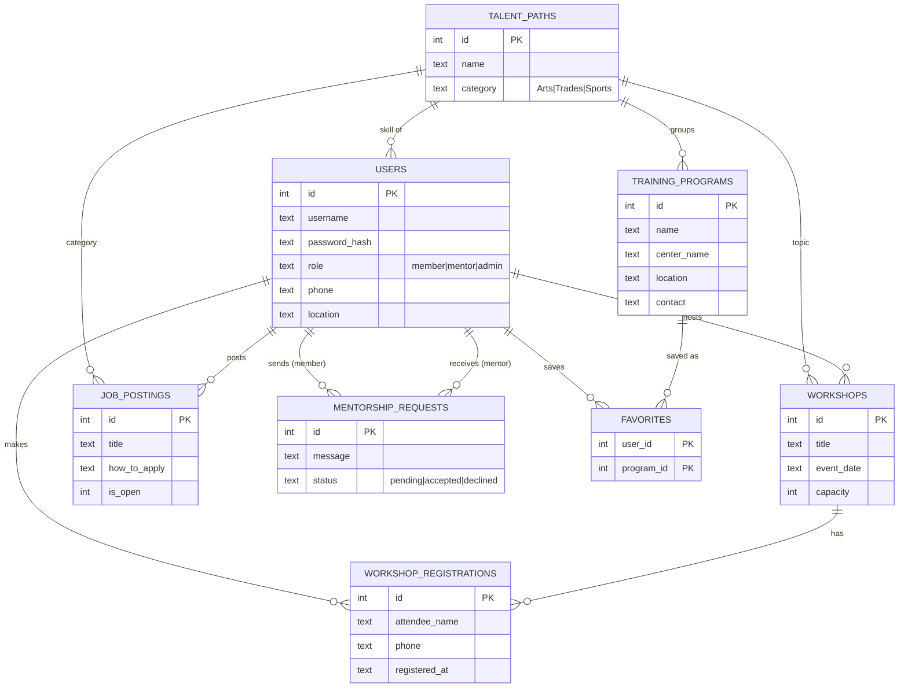

# Impano: Your Talent Is Your Education

**Peer Learning Project II · Group 2 · BSE Year 1, Trimester 2 · African Leadership University**

Impano (Kinyarwanda for *gift / talent*) is a menu-driven Python command-line app. It helps young people who left formal school to pursue a **trade, art or sport** find training centers, sign up for awareness workshops, connect with mentors and find job and business opportunities.

| GCGO | How Impano addresses it |
|---|---|
| **Education** | Treats practical trades and creative skills as a valid form of education. Awareness workshops push back against the stigma around them. |
| **Job Creation** | Mentors and admins post paid jobs, apprenticeships and gigs, which members can filter by skill category. |
| **Arts, Design & Culture** | Artists, musicians and performers get visibility, mentors and paid opportunities. |

---

## Features

### Core features (the PLP-1 must-haves)
1. **Search talent paths & training centers**: type a talent path (e.g. *Carpentry*, *Music*, or a category such as *Sports*) and, optionally, a location. The app lists matching programs with center, location and contact details.
2. **Register for awareness workshops**: pick a workshop ID and confirm your name and phone. The app checks that the ID exists, that the date hasn't passed, that you aren't already registered and that seats are left. Then it saves the registration.
3. **Discover job & business opportunities**: pick a category (Arts / Trades / Sports) and an optional location to see open postings with contact info and how to apply.

### Additional features
- **Mentor matching**: members search mentors by talent and location and send a request. Mentors accept or decline it, and the member then sees the mentor's contact.
- **Favorite programs** (the PLP-1 bonus feature): bookmark programs and view or remove them later. They're saved in the database, so they're still there after you log out.
- **Three user roles**, each with its own menu (see below), plus a **guest mode**.
- **Full CRUD** on programs, talent paths, workshops, jobs and users.
- **Secure log-in**: passwords are salted and hashed (PBKDF2-SHA256), never stored as plain text.
- **Crash-proof input**: typing letters where a number is expected, leaving fields empty, entering invalid dates or phones, or pressing Ctrl+C never crashes the app.

## User roles

| Role | Who | Can do |
|---|---|---|
| **Guest** | Anyone, no account | Search programs, browse jobs, mentors and workshops |
| **Member** | Talented young person (main user) | Everything a guest can do, plus register for or cancel workshops, request mentors, keep favorites and edit their profile |
| **Mentor** | Experienced practitioner | Answer mentorship requests, host workshops, see attendees, post, edit, close or delete their own jobs |
| **Admin** | Platform manager | CRUD on every table, change user roles, delete users, view statistics |

---

## Getting started

**Requirements:** Python 3.8 or newer. No extra packages: `sqlite3` ships with Python.

```bash
git clone https://github.com/anyieth-maker/Impano.git
cd impano
python main.py            # run the app
python main.py --reset    # wipe the database and reload sample data
```

The first run creates `impano.db` and fills it with sample data.

### Demo accounts

| Username | Password | Role |
|---|---|---|
| `admin` | `admin123` | Admin |
| `amani` | `mentor123` | Mentor (Carpentry, Kigali) |
| `grace` | `mentor123` | Mentor (Music, Juba) |
| `brian` | `mentor123` | Mentor (Football, Kigali) |
| `keza` | `member123` | Member (Music, Kigali) |

### Running the tests

```bash
python -m unittest discover tests -v
```

The 34 tests each run against a fresh in-memory database, so `impano.db` is never touched.

---

## Project architecture

The code is split into layers. Each layer only talks to the one directly below it:

```
 Keyboard / Terminal
        │
        ▼
┌─────────────────────┐   impano/cli/            Menus, prompts and printing. No SQL.
│   CLI (menus)       │
└─────────┬───────────┘
          ▼
┌─────────────────────┐   impano/services/       Business rules: validation, role
│   Services          │                          permissions, capacity checks
└─────────┬───────────┘
          ▼
┌─────────────────────┐   impano/repositories/   All SQL queries, one class per table
│   Repositories      │
└─────────┬───────────┘
          ▼
┌─────────────────────┐   impano/database/       The sqlite3 connection, schema and seed data
│   Database layer    │
└─────────┬───────────┘
          ▼
      impano.db  (SQLite)
```

`impano/container.py` connects the layers: it creates one `Database`, then the repositories, then the services. `impano/models.py` holds the classes (`User`, `TrainingProgram`, `Workshop` and so on) that pass data between the layers.

```
impano/
├── main.py                         # Entry point
├── impano/
│   ├── container.py                # Wires Database -> Repositories -> Services
│   ├── models.py                   # Dataclasses (Classes & Objects)
│   ├── database/
│   │   ├── connection.py           # Database class: the only sqlite3 code
│   │   ├── schema.sql              # CREATE TABLE statements
│   │   └── seed.py                 # Sample data + demo accounts
│   ├── repositories/               # SQL for each table
│   │   ├── user_repository.py
│   │   ├── talent_path_repository.py
│   │   ├── program_repository.py   # programs + favorites
│   │   ├── workshop_repository.py  # workshops + registrations
│   │   ├── job_repository.py
│   │   └── mentorship_repository.py
│   ├── services/                   # Rules and validation
│   │   ├── errors.py               # Custom exceptions
│   │   ├── validators.py           # Phone, date, username checks
│   │   ├── auth_service.py         # Sign up, log in, password hashing
│   │   ├── program_service.py      # Feature 1 + favorites
│   │   ├── workshop_service.py     # Feature 2
│   │   ├── job_service.py          # Feature 3
│   │   ├── mentorship_service.py
│   │   └── admin_service.py
│   └── cli/
│       ├── ui.py                   # Safe input helpers, tables, menu loop
│       ├── app.py                  # Welcome screen, log in, sign up, guest
│       ├── shared.py               # Feature screens used by several roles
│       ├── member_menu.py
│       ├── mentor_menu.py
│       └── admin_menu.py
├── tests/test_impano.py
└── docs/DEMO_GUIDE.md              # Presentation script + code map for QA
```

## Database schema

All data is stored in SQLite. There is **no CSV or JSON storage**. Foreign keys are enforced (`PRAGMA foreign_keys = ON`), so deleting a user also removes their registrations, requests and favorites.



### Example of data flow (workshop registration)

1. `cli/shared.py → register_workshop()` reads the workshop ID, name and phone from the keyboard.
2. `services/workshop_service.py → register()` checks that the workshop exists and its date hasn't passed, that the user isn't already registered, that seats are left and that the phone number is valid.
3. `repositories/workshop_repository.py → register()` runs `INSERT INTO workshop_registrations ...`
4. `database/connection.py → Database.insert()` executes the statement and commits it to `impano.db`.

## Class topics used

| Topic | Where |
|---|---|
| Loops & if/else | `cli/ui.py → run_menu()` repeats each menu until 0 is pressed |
| Lists & dictionaries | Menu options are dicts that map a number to (label, function); query results are lists of objects |
| Exceptions | `services/errors.py` custom errors; `ui.ask_int()` catches `ValueError` |
| Classes & objects | `models.py` dataclasses; every repository, service and menu is a class |
| SQL databases | `database/schema.sql` and every repository |

## Team

This project was designed, built, tested and documented by one group member.

**Others: did not contribute.**
